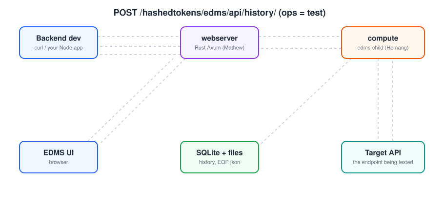
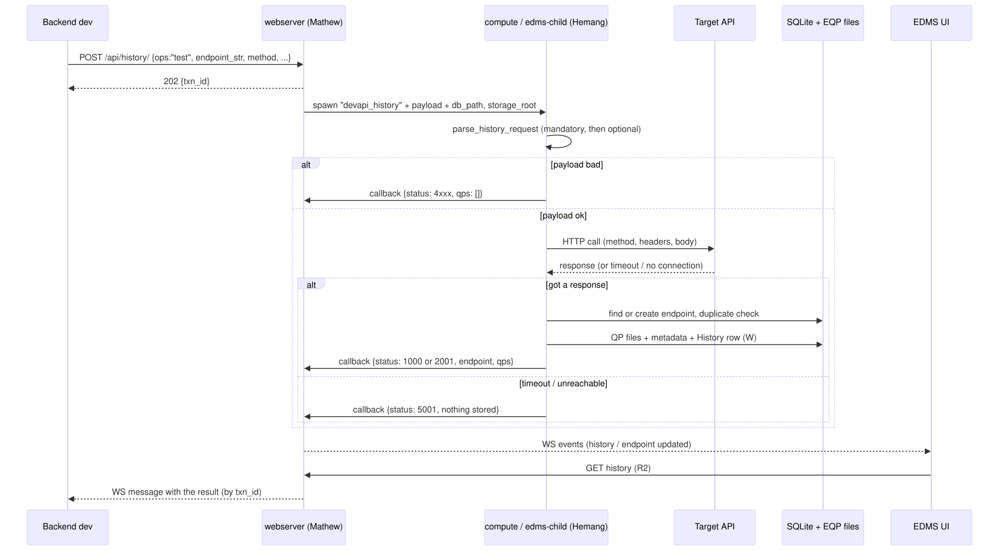
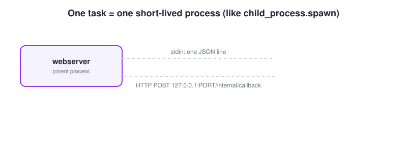
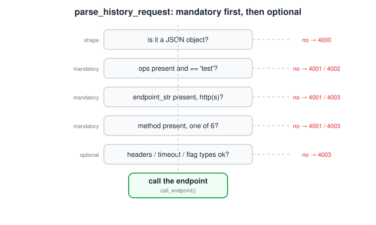
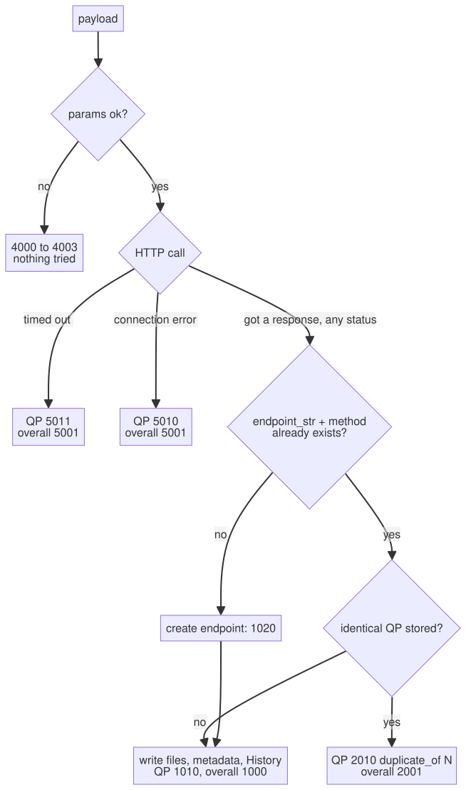
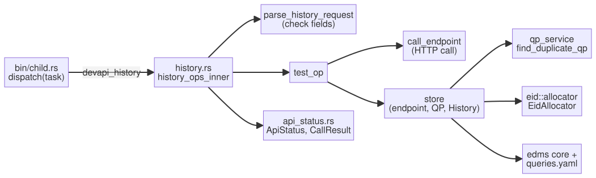

# Dev API: `/api/history/` (the compute part)

> **Out of date.** The code now follows Mathew's Dev API compute contract, and the sections below still describe the earlier design. What changed: the task is `api_history_test`; codes are linear (`0`, `-1`, `100`+) from `pkg/status_codes.md`; a call has one result (`status`, `endpoint_id`, `request_number`, `duplicate_of`, `endpoint_created`, `target_status`, `detail`) instead of per-endpoint and per-QP codes; `job_id` replaces `txn_id`; `return_response` and `ignored_params` are gone; `timeout_ms` is capped at 25 seconds. Trust `src/devapi/history.rs` and `tests/devapi_history_tests.rs` over the examples here.

> Written for a Node.js developer. Every Rust code block below is the real code from this branch (`hemang/devapi-history-compute`), pasted in by a script, not retyped. The example outputs come from actually running the `edms-child` binary against a fresh database.

**What this task is about:** let a backend developer put EQP data into EDMS by calling an API, instead of clicking around in the UI.
My part (Hemang) is the **compute** piece of `/hashedtokens/edms/api/history/` with `ops = "test"`:

> take the caller's JSON → check it → call their endpoint → **store** the endpoint, the QP and a History row exactly like Test View's **Run** does → hand back a **status code** that says what happened.

This follows the plan Mathew posted: he builds the webserver routes, Manorath does `/api/collections/`, and everyone uses one shared list of status codes (Mathew's PR 73).

---

## Contents

1. [The big picture](#1-the-big-picture)
2. [How the webserver talks to compute](#2-how-the-webserver-talks-to-compute)
3. [The API contract (what you send, what you get)](#3-the-api-contract)
4. [Status codes](#4-status-codes)
5. [Rust in 2 minutes, for Node devs](#5-rust-in-2-minutes-for-node-devs)
6. [Code walkthrough](#6-code-walkthrough)
7. [The same logic in Node.js](#7-the-same-logic-in-nodejs-for-understanding-only)
8. [Tests](#8-tests)
9. [What's done, what's not](#9-whats-done-whats-not)

---

## 1. The big picture



EDMS has three parts:

| Part | Node.js equivalent | Job |
|---|---|---|
| **webserver** (`backend/webserver`) | an Express app | routes, WebSocket events to the UI |
| **compute** (`backend/compute`, binary `edms-child`) | a worker script you start with `child_process.spawn` | does the heavy work, one process per task |
| **frontend** | the browser app | listens on a WebSocket, then re-fetches data over REST |

### The steps, in plain words

1. The backend dev sends `POST /api/history/` with `{ ops: "test", endpoint_str, method, ... }`.
2. The webserver replies **`202 Accepted` + a `txn_id`** right away. It doesn't wait for the test.
3. The webserver starts `edms-child` with the task `devapi_history`. It passes the dev's JSON plus two fields of its own: `db_path` and `storage_root`, so compute knows where the database and the EQP files live.
4. **Compute (my code)** checks the JSON and calls the dev's endpoint.
5. If the call got an answer, compute **stores it** (**W** = write):
   - it reuses the endpoint if one with the same `endpoint_str` + `method` exists, otherwise creates one with a new EID;
   - it checks for a **duplicate QP** with the same shared check Test View uses;
   - if it's new, it writes the request, response and headers files, the request/response metadata rows and a History row.
6. Compute sends the result back to the webserver and exits.
7. The webserver sends WebSocket events: the open UI refreshes (**R2** = second read), and the dev gets the result, matched by `txn_id`.

### Why `202` + WebSocket and not a normal response?

The server doesn't keep the HTTP request open while the test runs (the target API could take 30 seconds). So the dev gets the real result later over a WebSocket. It's like replying `res.status(202).json({ txn_id })` in Express and later doing `io.emit("result", ...)`.

### Who writes to the database?

In Test View today the webserver does the writes (in `callback.rs`). For the dev API, Mathew's plan puts them in the compute op ("run the endpoint and store the endpoint, QP and History row"). So **compute writes, and the webserver's callback for `devapi_history` must not write again**, or every entry would be stored twice. It only sends the events.



---

## 2. How the webserver talks to compute



This setup was already in the repo; I only plugged into it. Each task is a **new short-lived process**:

- The webserver writes one JSON line to the child's **stdin**: `{ task, payload, callback_port }`.
- The child runs the matching function and **POSTs** the result to `http://127.0.0.1:<callback_port>/internal/callback`.
- Then it exits.

In Node terms it's roughly:

```js
// parent (webserver)
const child = spawn("edms-child");
child.stdin.end(JSON.stringify({ task: "devapi_history", payload, callback_port: 3000 }));

// child (compute)
const { task, payload, callback_port } = JSON.parse(await readStdin());
const result = await dispatch(task, payload);          // ← my code runs in here
await fetch(`http://127.0.0.1:${callback_port}/internal/callback`, {
  method: "POST",
  body: JSON.stringify({ task, result, success: true, error: null, elapsed_ms }),
});
process.exit(0);
```

---

## 3. The API contract

These are the fields Mathew listed for the route, so the route and the op check the same things.

### What the dev sends

| Field | Required? | Type | Default | Meaning |
|---|---|---|---|---|
| `ops` | **yes** | string | – | must be `"test"` on this route |
| `endpoint_str` | **yes** | string | – | full `http://` or `https://` URL to test |
| `method` | **yes** | string | – | GET, POST, PUT, PATCH, DELETE, HEAD (any case) |
| `body` | no | any JSON | `null` | sent as JSON for POST/PUT/PATCH |
| `headers` | no | object of strings | `{}` | request headers |
| `timeout_ms` | no | positive integer | `30000` | give up after this long |
| `annotation` | no | string | `null` | saved only when a **new** endpoint is created |
| `notes` | no | string | `null` | accepted, but not stored yet (there's no column for it) |
| `return_response` | no | boolean | `false` | also send back the full response (body, headers, status) |
| `txn_id` | no | string | `null` | set by the webserver and echoed back so the result can be matched |
| anything else | – | – | – | ignored, and listed back in `ignored_params` |

The webserver also adds `db_path` and `storage_root`. They are not caller fields, so they never show up in `ignored_params`. If they're missing, compute falls back to the `EDMS_DB_PATH` and `EDMS_ROOT` environment variables.

The check order is **required fields first, then optional ones**:



### Real run 1: a new QP, with `return_response`

Run through the `edms-child` binary against a small local server and a fresh database. Response headers are shortened; temp paths aren't shown.

```json
{
  "payload_sent": {
    "ops": "test",
    "txn_id": "demo-1",
    "endpoint_str": "http://127.0.0.1:61534/users",
    "method": "post",
    "body": {
      "name": "Asha"
    },
    "return_response": true,
    "colour": "blue"
  },
  "callback": {
    "task": "devapi_history",
    "result": {
      "endpoint": {
        "code": 1020,
        "message": "A new endpoint was created",
        "name": "ENDPOINT_CREATED"
      },
      "endpoint_id": "E0001-AAA",
      "ignored_params": [
        "colour"
      ],
      "ops": "test",
      "qps": [
        {
          "detail": "201 in 2ms",
          "index": 0,
          "request_number": 1,
          "status": {
            "code": 1010,
            "message": "QP stored",
            "name": "QP_INSERTED"
          }
        }
      ],
      "response": {
        "body": {
          "id": 42,
          "name": "Asha"
        },
        "headers": {
          "content-type": "application/json",
          "...": "..."
        },
        "response_time_ms": 2,
        "status_code": 201
      },
      "status": {
        "code": 1000,
        "message": "Every QP was stored",
        "name": "OK"
      },
      "txn_id": "demo-1"
    },
    "success": true,
    "error": null
  }
}
```

Things to notice:
- `"method": "post"` became `"POST"`.
- `"colour"` isn't a known field, so it came back in `ignored_params` instead of being silently dropped.
- `success: true` is about the **process** (the child ran fine). What happened to the data is in `status`, `endpoint` and `qps`.
- `response` is there only because `return_response` was `true`.

### Real run 2: the same call again

```json
{
  "payload_sent": {
    "ops": "test",
    "txn_id": "demo-2",
    "endpoint_str": "http://127.0.0.1:61534/users",
    "method": "post",
    "body": {
      "name": "Asha"
    },
    "return_response": false,
    "colour": "blue"
  },
  "callback": {
    "task": "devapi_history",
    "result": {
      "endpoint": {
        "code": 1021,
        "message": "The endpoint already existed and was reused",
        "name": "ENDPOINT_REUSED"
      },
      "endpoint_id": "E0001-AAA",
      "ignored_params": [
        "colour"
      ],
      "ops": "test",
      "qps": [
        {
          "duplicate_of": 1,
          "index": 0,
          "status": {
            "code": 2010,
            "message": "An identical QP is already stored; it was not added again",
            "name": "QP_DUPLICATE_BLOCKED"
          }
        }
      ],
      "status": {
        "code": 2001,
        "message": "Every QP was a duplicate of one already stored; nothing was written",
        "name": "NOTHING_NEW"
      },
      "txn_id": "demo-2"
    },
    "success": true,
    "error": null
  }
}
```

Same request, same response, so the QP is blocked as a duplicate of QP 1 and nothing is written. The target's `date` header was different the second time, but the shared check ignores headers that change on every call.

### Real run 3: a bad payload (no `endpoint_str`)

```json
{
  "payload_sent": {
    "ops": "test",
    "method": "GET",
    "txn_id": "demo-3"
  },
  "callback": {
    "task": "devapi_history",
    "result": {
      "detail": "'endpoint_str' is required",
      "ops": "test",
      "qps": [],
      "status": {
        "code": 4001,
        "message": "A mandatory parameter is missing",
        "name": "MISSING_PARAM"
      },
      "txn_id": "demo-3"
    },
    "success": true,
    "error": null
  }
}
```

The bad payload still comes back as `success: true` with a clear code and a `detail`, not a crash. So the webserver always has a structured reply to forward to the dev.

### What was on disk and in the DB after the three runs

```text
files: E0001-AAA-headers-1.json, E0001-AAA-request-1.json, E0001-AAA-response-1.json
endpoints: [["E0001-AAA", "http://127.0.0.1:PORT/users", "POST"]]
request_metadata rows: 1
response_metadata: [[1, 201]]
history: [["E0001-AAA", "test", "201 in 2ms"]]
```

One endpoint, one QP (three files), one History row. The duplicate and the bad payload wrote nothing.

---

## 4. Status codes

The codes come from **`src/api_status.rs`**, which is Mathew's PR 73 copied in unchanged so the route and the op use the same list. A result has an **overall** `status`, an **`endpoint`** code, and one code **per QP**. The first digit is the group:

| Range | Meaning |
|---|---|
| `1xxx` | stored what was asked |
| `2xxx` | nothing failed, but not everything was stored (duplicates) |
| `4xxx` | the request itself is wrong, nothing was attempted |
| `5xxx` | the request was fine, the work didn't complete |

The codes this op can return:

| Code | Name | Where | When |
|---|---|---|---|
| **1000** | `OK` | overall | the QP was stored |
| **2001** | `NOTHING_NEW` | overall | the QP was a duplicate, nothing written |
| **4000** | `INVALID_REQUEST` | overall | payload isn't a JSON object |
| **4001** | `MISSING_PARAM` | overall | `ops`, `endpoint_str` or `method` missing or empty |
| **4002** | `UNKNOWN_OP` | overall | `ops` isn't `"test"` |
| **4003** | `INVALID_PARAM` | overall | bad URL, method like `TRACE`, or a wrong type (`timeout_ms: "soon"`) |
| **5000** | `INTERNAL_ERROR` | overall | compute failed (HTTP client, database or file write) |
| **5001** | `NOTHING_STORED` | overall | the test failed or timed out |
| **1010** | `QP_INSERTED` | QP | stored as `request_number` N |
| **2010** | `QP_DUPLICATE_BLOCKED` | QP | identical to QP `duplicate_of` |
| **5010** | `QP_TEST_FAILED` | QP | couldn't connect (wrong port, DNS, refused) |
| **5011** | `QP_TEST_TIMED_OUT` | QP | no answer within `timeout_ms` |
| **1020** | `ENDPOINT_CREATED` | endpoint | new endpoint row with a new EID |
| **1021** | `ENDPOINT_REUSED` | endpoint | same `endpoint_str` + `method` already existed |

- **A non-2xx answer (404, 500…) is still stored**, as `QP_INSERTED`, the same as Test View. It's real EQP data. The status code is in the QP's `detail` and in `response_metadata`.
- **A timeout or connection error stores nothing**, not even a new endpoint.
- The overall code is worked out from the QP codes by `CallResult::from_qps` in `api_status.rs`, so it always agrees with them.



---

## 5. Rust in 2 minutes, for Node devs

Enough to read the code below.

| Rust | Node.js idea |
|---|---|
| `async fn f() -> T` / `.await` | same as `async function` / `await` |
| `Result<T, E>` | a function that either returns a value (`Ok(v)`) or an error (`Err(e)`), instead of `throw` |
| `?` after a call | "if this is an error, `return` it now", like `if (err) return err` |
| `Option<T>` = `Some(v)` / `None` | a value or `undefined` |
| `match x { ... }` | a `switch` that must cover every case |
| `enum ApiStatus { A, B }` | like a TypeScript union `"A" \| "B"` |
| `struct Paths { db_path: String }` | a plain object type, like a TS `interface` |
| `QpOutcome { detail: x, ..QpOutcome::new(0, s) }` | `{ ...newQpOutcome(0, s), detail: x }` |
| `json!({ "a": 1 })` | a plain JS object literal |
| `serde_json::Value` | "any JSON", like `unknown` from `JSON.parse` |
| `&str` vs `String` | a borrowed read-only string vs an owned one; you can mostly ignore the difference here |
| `HashMap<String, String>` | `Record<string, string>` |
| `pub` | `export` |
| `use x::y;` | `import { y } from "x"` |
| `mod foo;` | "there's a file `foo.rs` in this module" |
| `#[test]` / `#[tokio::test]` | `it(...)` / an async `it(...)` |

---

## 6. Code walkthrough

### Files

| File | What | Lines |
|---|---|---|
| `src/devapi/mod.rs` | new: declares the module | 4 |
| `src/devapi/history.rs` | new: the `test` op (check, call, store) | 317 |
| `src/api_status.rs` | Mathew's PR 73, copied in unchanged | 423 |
| `src/lib.rs` | +2 lines: `api_status`, `devapi` | |
| `src/bin/child.rs` | +3 lines: route the `devapi_history` task | |
| `tests/devapi_history_tests.rs` | new: 11 tests | 273 |
| `tests/ipc_child_test.rs` | +1 test through the real binary | |

Code it **uses** that was already on `tmp`:
- `qp_service::find_duplicate_qp`: the duplicate check Test View uses. Using the same function means the dev API and Test View block exactly the same things.
- `eid::allocator::EidAllocator`: hands out new EIDs. It keeps its own state in the DB, so it must be shared, not copied.
- `edms::EdmsCore` + `QueryMap`: the DB connection and the named queries in `queries.yaml` (`E8`, `E1`, `R6`, `R1`, `RES1`, `H3`), the same ones the webserver's `db.rs` uses.

The HTTP call itself (`call_endpoint`) is a **fresh copy** of `api::handlers::run_test_inner`, not an import, as the task brief asks, so this route can change without touching Test View.



---

### 6.1 `src/devapi/mod.rs`

```rust
//! Dev API ops (insert EQP data without the UI). Status codes live in
//! crate::api_status, shared with the webserver routes.

pub mod history;
```

This is like an `index.js` that says "this folder has `history`".

---

### 6.2 The part of `src/api_status.rs` the op uses

The whole file is Mathew's; these are the two types the result is built from:

```rust
/// What happened to one QP of the call. `index` is its position in the
/// request's `qps` list.
#[derive(Debug, Clone, PartialEq, Serialize, Deserialize)]
pub struct QpOutcome {
    pub index: usize,
    pub status: ApiStatus,
    /// The QP number it was stored as (`QpInserted`).
    #[serde(default, skip_serializing_if = "Option::is_none")]
    pub request_number: Option<i32>,
    /// The QP it duplicates (`QpDuplicateBlocked`).
    #[serde(default, skip_serializing_if = "Option::is_none")]
    pub duplicate_of: Option<i32>,
    /// Extra text for the person reading the log (what was wrong, the error).
    #[serde(default, skip_serializing_if = "Option::is_none")]
    pub detail: Option<String>,
}

impl QpOutcome {
    pub fn new(index: usize, status: ApiStatus) -> Self {
        QpOutcome { index, status, request_number: None, duplicate_of: None, detail: None }
    }
}

/// The whole result of a call, as delivered over the WebSocket.
#[derive(Debug, Clone, PartialEq, Serialize, Deserialize)]
pub struct CallResult {
    pub status: ApiStatus,
    #[serde(default, skip_serializing_if = "Option::is_none")]
    pub endpoint: Option<ApiStatus>,
    #[serde(default, skip_serializing_if = "Option::is_none")]
    pub collection: Option<ApiStatus>,
    pub qps: Vec<QpOutcome>,
}

impl CallResult {
    /// Builds the result with the overall code worked out from the QPs.
    pub fn from_qps(
        endpoint: Option<ApiStatus>,
        collection: Option<ApiStatus>,
        qps: Vec<QpOutcome>,
    ) -> Self {
        CallResult { status: overall(&qps), endpoint, collection, qps }
    }
}
```

- **`QpOutcome`:** what happened to one QP. `request_number` is set when stored, `duplicate_of` when blocked, `detail` for a human-readable note.
- **`CallResult`:** the whole result. `from_qps` works out the overall `status` from the QPs, so the op never picks the overall code by hand.
- On the wire every status is `{ code, name, message }`, which is what you see in the real runs above.

---

### 6.3 `src/devapi/history.rs`

```rust
//! /api/history/ ops "test": run the endpoint, then store the endpoint, QP and
//! history row the same way Test View's Run does. Codes: crate::api_status.
//! Mandatory: ops, endpoint_str, method. Optional: body, headers, timeout_ms,
//! annotation, notes, return_response, txn_id.

use std::collections::HashMap;
use std::path::PathBuf;
use std::time::{Duration, Instant};

use edms::{EdmsCore, query_loader::QueryMap};
use serde_json::{Map, Value, json};

// explicit list: a glob would pull in ApiStatus::Ok over Result::Ok
use crate::api_status::ApiStatus::{
    self, EndpointCreated, EndpointReused, InternalError, InvalidParam, InvalidRequest,
    MissingParam, QpDuplicateBlocked, QpInserted, QpTestFailed, QpTestTimedOut, UnknownOp,
};
use crate::api_status::{CallResult, QpOutcome};
use crate::eid::allocator::EidAllocator;
use crate::qp_service::find_duplicate_qp;

const METHODS: [&str; 6] = ["GET", "POST", "PUT", "PATCH", "DELETE", "HEAD"];
// db_path and storage_root are added by the webserver, not the caller
const KNOWN: [&str; 12] = [
    "ops", "endpoint_str", "method", "body", "headers", "timeout_ms", "annotation", "notes",
    "return_response", "txn_id", "db_path", "storage_root",
];

type Rejection = (ApiStatus, String);
type DynResult<T> = Result<T, Box<dyn std::error::Error + Send + Sync>>;

#[derive(Debug, Clone)]
pub struct HistoryTestRequest {
    pub endpoint_str: String,
    pub method: String,
    pub body: Value,
    pub headers: HashMap<String, String>,
    pub timeout_ms: u64,
    pub annotation: Option<String>,
    pub notes: Option<String>,
    pub return_response: bool,
    pub ignored_params: Vec<String>,
}

/// What the target answered.
#[derive(Debug, Clone)]
pub struct Tested {
    pub status_code: i64,
    pub response_time_ms: i64,
    pub headers: HashMap<String, String>,
    pub body: Value,
}

// IPC task "devapi_history"; always Ok, the outcome is in `status`
pub async fn history_ops_inner(payload: Value) -> Result<String, String> {
    let mut out = match parse_history_request(&payload) {
        Err((status, detail)) => rejected(status, detail),
        Ok(req) => {
            let mut out = test_op(&req, &payload).await;
            out["ignored_params"] = json!(req.ignored_params);
            out
        }
    };
    out["txn_id"] = payload.get("txn_id").cloned().unwrap_or(Value::Null);
    out["ops"] = payload.get("ops").cloned().unwrap_or(Value::Null);
    Ok(out.to_string())
}

pub fn parse_history_request(payload: &Value) -> Result<HistoryTestRequest, Rejection> {
    let obj = payload
        .as_object()
        .ok_or((InvalidRequest, "payload must be a JSON object".into()))?;

    // mandatory
    let ops = required(obj, "ops")?;
    if ops != "test" {
        return Err((UnknownOp, format!("ops '{ops}' not supported (use: test)")));
    }
    let endpoint_str = required(obj, "endpoint_str")?;
    match url::Url::parse(endpoint_str) {
        Ok(u) if matches!(u.scheme(), "http" | "https") => {}
        _ => return Err((InvalidParam, format!("endpoint_str '{endpoint_str}' must be an http(s) URL"))),
    }
    let method = required(obj, "method")?.to_uppercase();
    if !METHODS.contains(&method.as_str()) {
        return Err((InvalidParam, format!("method '{method}' not supported")));
    }

    // optional
    let mut headers = HashMap::new();
    match obj.get("headers") {
        None | Some(Value::Null) => {}
        Some(Value::Object(map)) => {
            for (k, v) in map {
                let v = v.as_str().ok_or_else(|| wrong_type(&format!("headers.{k}")))?;
                headers.insert(k.clone(), v.to_string());
            }
        }
        Some(_) => return Err(wrong_type("headers")),
    }

    let timeout_ms = match obj.get("timeout_ms") {
        None | Some(Value::Null) => 30_000,
        Some(v) => v.as_u64().filter(|ms| *ms > 0).ok_or_else(|| wrong_type("timeout_ms"))?,
    };

    let return_response = match obj.get("return_response") {
        None | Some(Value::Null) => false,
        Some(v) => v.as_bool().ok_or_else(|| wrong_type("return_response"))?,
    };

    Ok(HistoryTestRequest {
        endpoint_str: endpoint_str.into(),
        method,
        body: obj.get("body").cloned().unwrap_or(Value::Null),
        headers,
        timeout_ms,
        annotation: optional(obj, "annotation")?,
        notes: optional(obj, "notes")?,
        return_response,
        ignored_params: obj.keys().filter(|k| !KNOWN.contains(&k.as_str())).cloned().collect(),
    })
}

fn required<'a>(obj: &'a Map<String, Value>, key: &str) -> Result<&'a str, Rejection> {
    match obj.get(key) {
        None | Some(Value::Null) => Err((MissingParam, format!("'{key}' is required"))),
        Some(Value::String(s)) if !s.trim().is_empty() => Ok(s.trim()),
        Some(Value::String(_)) => Err((MissingParam, format!("'{key}' is empty"))),
        Some(_) => Err(wrong_type(key)),
    }
}

fn optional(obj: &Map<String, Value>, key: &str) -> Result<Option<String>, Rejection> {
    match obj.get(key) {
        None | Some(Value::Null) => Ok(None),
        Some(Value::String(s)) => Ok(Some(s.clone())),
        Some(_) => Err(wrong_type(key)),
    }
}

fn wrong_type(key: &str) -> Rejection {
    (InvalidParam, format!("'{key}' has the wrong type"))
}

// a rejected call: nothing tried, no QPs
fn rejected(status: ApiStatus, detail: String) -> Value {
    let mut out = json!(CallResult { status, endpoint: None, collection: None, qps: vec![] });
    out["detail"] = json!(detail);
    out
}

// run, then store; the response is only echoed back when asked
async fn test_op(req: &HistoryTestRequest, payload: &Value) -> Value {
    let tested = match call_endpoint(req).await {
        Ok(t) => t,
        Err((InternalError, detail)) => return rejected(InternalError, detail),
        Err((status, detail)) => {
            let qp = QpOutcome { detail: Some(detail), ..QpOutcome::new(0, status) };
            return json!(CallResult::from_qps(None, None, vec![qp]));
        }
    };

    let mut out = match store(req, &tested, &Paths::from(payload)) {
        Ok((endpoint_id, endpoint, qp)) => {
            let mut out = json!(CallResult::from_qps(Some(endpoint), None, vec![qp]));
            out["endpoint_id"] = json!(endpoint_id);
            out
        }
        Err(e) => rejected(InternalError, format!("store failed: {e}")),
    };
    if req.return_response {
        out["response"] = json!({
            "status_code": tested.status_code,
            "response_time_ms": tested.response_time_ms,
            "headers": tested.headers,
            "body": tested.body,
        });
    }
    out
}

// fresh copy of api::handlers::run_test_inner
pub async fn call_endpoint(req: &HistoryTestRequest) -> Result<Tested, Rejection> {
    let client = reqwest::Client::builder()
        .timeout(Duration::from_millis(req.timeout_ms))
        .build()
        .map_err(|e| (InternalError, format!("http client: {e}")))?;
    let url = &req.endpoint_str;
    let mut http = match req.method.as_str() {
        "POST" => client.post(url).json(&req.body),
        "PUT" => client.put(url).json(&req.body),
        "PATCH" => client.patch(url).json(&req.body),
        "DELETE" => client.delete(url),
        "HEAD" => client.head(url),
        _ => client.get(url),
    };
    for (k, v) in &req.headers {
        http = http.header(k, v);
    }

    let start = Instant::now();
    match http.send().await {
        Ok(resp) => {
            let response_time_ms = start.elapsed().as_millis() as i64;
            let status_code = resp.status().as_u16() as i64;
            let headers = resp
                .headers()
                .iter()
                .filter_map(|(k, v)| Some((k.to_string(), v.to_str().ok()?.to_string())))
                .collect();
            let text = resp.text().await.unwrap_or_default();
            let body = serde_json::from_str(&text).unwrap_or(Value::String(text));
            Ok(Tested { status_code, response_time_ms, headers, body })
        }
        Err(e) if e.is_timeout() => Err((QpTestTimedOut, format!("no response in {}ms", req.timeout_ms))),
        Err(e) => Err((QpTestFailed, format!("unreachable: {e}"))),
    }
}

/// Where the DB and EQP files live. The webserver passes both; the env
/// fallbacks match what the webserver and edms-child use.
pub struct Paths {
    pub db_path: String,
    pub storage_root: PathBuf,
}

impl Paths {
    pub fn from(payload: &Value) -> Self {
        let db_path = payload["db_path"].as_str().map(String::from)
            .or_else(|| std::env::var("EDMS_DB_PATH").ok())
            .unwrap_or_else(|| "edms.db".into());
        let storage_root = payload["storage_root"].as_str().map(PathBuf::from)
            .or_else(|| std::env::var_os("EDMS_ROOT").map(PathBuf::from))
            .unwrap_or_else(crate::folder_manager::default_root_path);
        Paths { db_path, storage_root }
    }

    fn endpoint_dir(&self, eid: &str) -> PathBuf {
        self.storage_root.join("storage").join("globalEQPData").join(eid)
    }
}

// same writes as Test View's run_test_impl + handle_run_test:
// endpoint (reuse or create), duplicate check, 3 files, request/response
// metadata, history row
pub fn store(req: &HistoryTestRequest, t: &Tested, paths: &Paths) -> DynResult<(String, ApiStatus, QpOutcome)> {
    let core = EdmsCore::new(&paths.db_path);
    core.connect()?;
    let q = QueryMap::load();

    let request = req.body.to_string();
    let response = t.body.to_string();
    let headers = json!({ "request_headers": req.headers, "response_headers": t.headers }).to_string();

    let found: Option<String> = core
        .cproc(sql(q.get_endpoint_query("E8"))?, &[&req.endpoint_str, &req.method], |r| r.get(0))?
        .into_iter()
        .next();

    let (eid, endpoint) = match found {
        Some(eid) => {
            let dir = paths.endpoint_dir(&eid);
            let dup = find_duplicate_qp(&dir, &eid, &req.method, &req.endpoint_str, &request, &response, &headers, None);
            if let Some(n) = dup.filter(|n| *n > 0) {
                let qp = QpOutcome { duplicate_of: Some(n), ..QpOutcome::new(0, QpDuplicateBlocked) };
                return Ok((eid, EndpointReused, qp));
            }
            (eid, EndpointReused)
        }
        None => (create_endpoint(&core, &q, req, &paths.db_path)?, EndpointCreated),
    };

    let n: i32 = core
        .cproc(sql(q.get_request_query("R6"))?, &[&eid], |r| r.get::<_, Option<i32>>(0))?
        .into_iter()
        .flatten()
        .next()
        .map_or(1, |max| max + 1);

    let dir = paths.endpoint_dir(&eid);
    std::fs::create_dir_all(&dir)?;
    let file = |kind: &str| dir.join(format!("{eid}-{kind}-{n}.json"));
    std::fs::write(file("request"), &request)?;
    std::fs::write(file("response"), &response)?;
    std::fs::write(file("headers"), &headers)?;

    let (req_file, res_file) = (file("request").display().to_string(), file("response").display().to_string());
    let (code, ms) = (t.status_code as i32, t.response_time_ms as i32);
    let details = format!("{code} in {ms}ms");
    core.proc(sql(q.get_request_query("R1"))?, &[&eid, &n, &req_file, &req.method])?;
    core.proc(sql(q.get_response_query("RES1"))?, &[&eid, &n, &res_file, &code, &ms])?;
    core.proc(sql(q.get_history_query("H3"))?, &[&eid, &"test", &details])?;

    let qp = QpOutcome { request_number: Some(n), detail: Some(details), ..QpOutcome::new(0, QpInserted) };
    Ok((eid, endpoint, qp))
}

// new EID from the shared allocator, then E1; give the EID back on failure
fn create_endpoint(core: &EdmsCore, q: &QueryMap, req: &HistoryTestRequest, db_path: &str) -> DynResult<String> {
    let allocator = EidAllocator::new(db_path);
    allocator.initialize().map_err(|e| format!("eid init: {e}"))?;
    let eid = allocator.allocate().map_err(|e| format!("eid allocate: {e}"))?;
    let insert = core.proc(
        sql(q.get_endpoint_query("E1"))?,
        &[&eid, &req.endpoint_str, &req.annotation, &req.method],
    );
    if let Err(e) = insert {
        let _ = allocator.release(&eid);
        return Err(e.into());
    }
    Ok(eid)
}

fn sql(query: Option<&str>) -> DynResult<&str> {
    query.ok_or_else(|| "query missing from queries.yaml".into())
}
```

#### Top: imports, constants and types

- **The import list is explicit on purpose.** `ApiStatus` has a variant called `Ok`; a `*` import would hide Rust's own `Ok(...)` and nothing would compile.
- **`METHODS`:** the allowed HTTP methods.
- **`KNOWN`:** every field name we understand, including the two the webserver adds. Anything else goes into `ignored_params`.
- **`Rejection`:** a pair like `[InvalidParam, "method 'TRACE' not supported"]`.
- **`HistoryTestRequest`:** the cleaned-up, typed version of the dev's JSON.
- **`Tested`:** what the target answered.

#### `history_ops_inner(payload)`: the entry point

The function `child.rs` calls. It **always returns `Ok`**, even for a bad payload. If it returned `Err`, the IPC layer would send back `success: false` with just an error string, and the dev would get no code. This way every outcome has a code. It always adds `txn_id` and `ops` to the result.

#### `parse_history_request(payload)`: checking fields

Mandatory first, then optional:

1. **Is it a JSON object?** If not → `4000`.
2. **`ops`:** required, and must be `"test"` → `4001` if missing, `4002` if something else.
3. **`endpoint_str`:** required, then parsed with the `url` crate; must be http or https → `4001` / `4003`.
4. **`method`:** required, uppercased, must be in `METHODS` → `4001` / `4003`.
5. **`headers`:** optional; an object whose values are all strings → `4003`.
6. **`timeout_ms`:** optional; a positive integer, defaults to `30000` → `4003`.
7. **`return_response`:** optional boolean, defaults to `false` → `4003`.
8. **`annotation`, `notes`:** optional strings → `4003`.
9. **`body`:** anything goes. **`ignored_params`:** every key not in `KNOWN`.

Helpers: `required` (missing, `null` or empty → `4001`; not a string → `4003`), `optional` (missing or `null` → `None`), `wrong_type` (builds the `4003`), `rejected` (a `CallResult` with no QPs plus a `detail`).

#### `test_op(req, payload)`: call, then store

1. `call_endpoint`. On timeout or connection error it returns a QP with `5011` / `5010` and stops: nothing is stored.
2. `store`. On success the result has the endpoint code, the QP and `endpoint_id`. If storing fails, the overall code is `5000` with the error in `detail`.
3. If `return_response` is set, the full response is added.

#### `call_endpoint(req)`: the HTTP call

1. Build an HTTP client with the timeout.
2. POST, PUT and PATCH send `body` as JSON. GET, DELETE and HEAD send no body, same as Test View.
3. Add the headers and send. Like `fetch(url, { method, headers, body, signal: AbortSignal.timeout(ms) })`.
4. Read the status, the time, the headers and the body. The body is kept as JSON if it parses, otherwise as a string, same as Test View.

#### `Paths`: where things live

`db_path` and `storage_root` from the payload, falling back to the environment. EQP files go in `<storage_root>/storage/globalEQPData/<EID>/`, the same folder Test View uses.

#### `store(req, tested, paths)`: the writes

This does what Test View's `run_test_impl` + `handle_run_test` do together:

1. Turn the request body, response body and `{request_headers, response_headers}` into the exact strings Test View writes to its three files.
2. Query **`E8`**: is there an endpoint with this `endpoint_str` + `method`?
3. If there is, run **`find_duplicate_qp`** on its folder. A match means `QP_DUPLICATE_BLOCKED` with `duplicate_of`, and nothing is written.
4. If there isn't, `create_endpoint`: take a new EID from the allocator and insert it with **`E1`**. If the insert fails, the EID is given back.
5. **`R6`** gives the highest `request_number` so far; this QP is that plus one.
6. Write `<EID>-request-N.json`, `<EID>-response-N.json` and `<EID>-headers-N.json`.
7. Insert the rows: **`R1`** (request metadata), **`RES1`** (response metadata with status code and time), **`H3`** (History, action `"test"`, details like `"201 in 2ms"`, the same text Test View writes).

`sql(...)` turns a missing query name into an error instead of a crash.

---

### 6.4 `src/bin/child.rs` and `src/lib.rs` (the only edits to existing files)

```diff
diff --git a/backend/compute/src/bin/child.rs b/backend/compute/src/bin/child.rs
index ed4797b..0d012ac 100644
--- a/backend/compute/src/bin/child.rs
+++ b/backend/compute/src/bin/child.rs
@@ -416,6 +416,9 @@ async fn dispatch(task: &str, payload: Value) -> (bool, Value, Option<String>) {
             run(payload, |p: PurgeRequest| purge_orphaned_eids_inner(p)).await
         }
 
+        // Dev API: /api/history/
+        "devapi_history" => run(payload, compute::devapi::history::history_ops_inner).await,
+
         unknown => {
             let msg = format!("unknown task: '{}'", unknown);
             eprintln!("[edms-child] {msg}");
diff --git a/backend/compute/src/lib.rs b/backend/compute/src/lib.rs
index aecf4c2..b31dac3 100644
--- a/backend/compute/src/lib.rs
+++ b/backend/compute/src/lib.rs
@@ -15,3 +15,5 @@ pub mod audit_orphanedEIDs;
 pub mod file_converter;
 
 pub mod qp_service;
+pub mod api_status;
+pub mod devapi;
```

- **`lib.rs`:** registers the two new modules. (`qp_service` was already there on `tmp`.)
- **`child.rs`:** adds one more `case` to the existing task `switch`. `run(payload, fn)` is an existing helper that turns the JSON into the function's input, awaits it, and turns the returned string back into JSON for the callback.

---

## 7. The same logic in Node.js (for understanding only)

This is **not in the repo**. It's the Rust above, translated so you can compare. To keep it short it leaves out the type checks on `headers`, `annotation` and `notes`, and uses made-up helpers (`db`, `findDuplicateQp`, `allocateEid`) for the parts that live in other files.

```js
const METHODS = ["GET", "POST", "PUT", "PATCH", "DELETE", "HEAD"];

function parseHistoryRequest(p) {
  const reject = (code, detail) => { throw { code, detail }; };
  if (typeof p !== "object" || p === null || Array.isArray(p)) reject(4000, "payload must be a JSON object");

  // mandatory
  const required = (k) => {
    if (p[k] == null) reject(4001, `'${k}' is required`);
    if (typeof p[k] !== "string") reject(4003, `'${k}' has the wrong type`);
    if (!p[k].trim()) reject(4001, `'${k}' is empty`);
    return p[k].trim();
  };
  const ops = required("ops");
  if (ops !== "test") reject(4002, `ops '${ops}' not supported (use: test)`);
  const endpoint_str = required("endpoint_str");
  try { if (!["http:", "https:"].includes(new URL(endpoint_str).protocol)) throw 0; }
  catch { reject(4003, `endpoint_str '${endpoint_str}' must be an http(s) URL`); }
  const method = required("method").toUpperCase();
  if (!METHODS.includes(method)) reject(4003, `method '${method}' not supported`);

  // optional
  const timeout_ms = p.timeout_ms ?? 30000;
  if (!Number.isInteger(timeout_ms) || timeout_ms <= 0) reject(4003, "'timeout_ms' has the wrong type");
  const return_response = p.return_response ?? false;
  if (typeof return_response !== "boolean") reject(4003, "'return_response' has the wrong type");

  return { endpoint_str, method, timeout_ms, return_response,
           body: p.body ?? null, headers: p.headers ?? {}, annotation: p.annotation ?? null };
}

async function callEndpoint(req) {
  const sendsBody = ["POST", "PUT", "PATCH"].includes(req.method);
  const start = Date.now();
  try {
    const res = await fetch(req.endpoint_str, {
      method: req.method,
      headers: sendsBody ? { "content-type": "application/json", ...req.headers } : req.headers,
      body: sendsBody ? JSON.stringify(req.body) : undefined,
      signal: AbortSignal.timeout(req.timeout_ms),
    });
    const text = await res.text();
    let body; try { body = JSON.parse(text); } catch { body = text; }
    return { status_code: res.status, response_time_ms: Date.now() - start,
             headers: Object.fromEntries(res.headers), body };
  } catch (e) {
    throw e.name === "TimeoutError" ? { qp: 5011 } : { qp: 5010 };   // nothing stored
  }
}

function store(req, t, paths) {
  const files = {
    request: JSON.stringify(req.body),
    response: JSON.stringify(t.body),
    headers: JSON.stringify({ request_headers: req.headers, response_headers: t.headers }),
  };
  let eid = db.get("E8", req.endpoint_str, req.method)?.endpoint_id;
  let endpoint = 1021;                                            // ENDPOINT_REUSED
  if (eid) {
    const dup = findDuplicateQp(dirOf(paths, eid), eid, req, files);
    if (dup) return { eid, endpoint, qp: { status: 2010, duplicate_of: dup } };
  } else {
    eid = allocateEid();
    db.run("E1", eid, req.endpoint_str, req.annotation, req.method);
    endpoint = 1020;                                              // ENDPOINT_CREATED
  }
  const n = (db.get("R6", eid) ?? 0) + 1;
  const file = (kind) => `${dirOf(paths, eid)}/${eid}-${kind}-${n}.json`;
  for (const [kind, text] of Object.entries(files)) fs.writeFileSync(file(kind), text);
  const details = `${t.status_code} in ${t.response_time_ms}ms`;
  db.run("R1", eid, n, file("request"), req.method);
  db.run("RES1", eid, n, file("response"), t.status_code, t.response_time_ms);
  db.run("H3", eid, "test", details);
  return { eid, endpoint, qp: { status: 1010, request_number: n, detail: details } };
}
```

---

## 8. Tests

Run them:

```bash
cd backend/compute
cargo test --test devapi_history_tests --test ipc_child_test
```

Result on my machine: **11 passed** in `devapi_history_tests` and **5 passed** in `ipc_child_test` (4 existing + 1 new). The 10 tests in `api_status.rs` (Mathew's) pass too.

The tests that store data each get their own **temporary database** (with the real EDMS schema) and storage folder, so they never touch your real data. They pass `db_path` and `storage_root` in the payload, the same way the webserver will.

### What each test proves

| Test | Proves |
|---|---|
| `mandatory_params_are_checked_first` | missing `ops`, `endpoint_str` or `method`, or an empty one → `4001`, with a `detail` naming the field |
| `non_object_and_unknown_op_are_rejected` | a non-object → `4000`; `ops: "insert"` → `4002` |
| `bad_values_are_invalid_param` | bad URL, `ftp://`, `TRACE`, number header, `timeout_ms: "soon"`, `return_response: "yes"`, numeric `annotation` → `4003` |
| `optional_params_default_and_unknown_keys_are_reported` | defaults (30000, `{}`, null, `false`), uppercasing; `db_path` isn't reported as unknown but `colour` is |
| `txn_id_is_echoed_even_on_failure` | `txn_id` comes back even when rejected |
| `test_stores_endpoint_qp_files_and_history` | a real POST: `1000`, `ENDPOINT_CREATED`, QP 1, all three files, one row in each table, method and annotation saved; no `response` unless asked |
| `same_qp_twice_is_blocked_new_body_is_stored` | the same call again → `2001`, `duplicate_of: 1`, same endpoint; a different body → QP 2 |
| `return_response_echoes_the_full_response` | status, headers and body come back when asked |
| `non_2xx_is_stored_like_test_view` | a 404 is stored (`1000`), with 404 in `response_metadata` |
| `timeout_stores_nothing` | 200ms timeout vs a 2s endpoint → `5001` / `5011`, no endpoint, no History |
| `unreachable_target_stores_nothing` | nothing listening → `5001` / `5010`, no endpoint |
| `test_child_devapi_history_reports_status_code` (in `ipc_child_test.rs`) | goes through the **real `edms-child` binary** and gets a coded callback |

The tests start a tiny local server (with `warp`, like a 10-line Express app) with three routes: `/echo` (201), `/missing` (404) and `/slow` (sleeps 2s).

<details>
<summary>Full test file (click to open)</summary>

```rust
// Dev API /api/history/ tests

use compute::devapi::history::{history_ops_inner, parse_history_request};
use rusqlite::Connection;
use serde_json::{Value, json};
use std::path::PathBuf;
use std::time::Duration;

// temp DB (with schema) + storage root, passed the way the webserver will
struct Env {
    _dir: tempfile::TempDir,
    db: PathBuf,
    root: PathBuf,
}

fn env() -> Env {
    let dir = tempfile::tempdir().unwrap();
    let db = dir.path().join("edms.db");
    let core = edms::EdmsCore::new(db.to_str().unwrap());
    core.connect().unwrap();
    edms::schema::initialize_schema_from_core(&core).unwrap();
    let root = dir.path().join("root");
    Env { db, root, _dir: dir }
}

impl Env {
    async fn run(&self, mut payload: Value) -> Value {
        payload["db_path"] = json!(self.db.to_str().unwrap());
        payload["storage_root"] = json!(self.root.to_str().unwrap());
        run(payload).await
    }

    fn count(&self, table: &str) -> i64 {
        let conn = Connection::open(&self.db).unwrap();
        conn.query_row(&format!("SELECT COUNT(*) FROM {table}"), [], |r| r.get(0)).unwrap()
    }

    fn file(&self, eid: &str, kind: &str, n: i64) -> PathBuf {
        self.root.join("storage/globalEQPData").join(eid).join(format!("{eid}-{kind}-{n}.json"))
    }
}

async fn run(payload: Value) -> Value {
    let out = history_ops_inner(payload).await.expect("compute never errors at the IPC level");
    serde_json::from_str(&out).expect("result is JSON")
}

fn code(r: &Value) -> i64 {
    r["status"]["code"].as_i64().unwrap()
}

// local target: /echo (201), /missing (404), /slow (2s)
async fn start_target() -> u16 {
    use warp::Filter;
    let port = portpicker::pick_unused_port().expect("No free port");

    let echo = warp::path("echo")
        .and(warp::post())
        .and(warp::header::optional::<String>("x-dev"))
        .and(warp::body::json())
        .map(|dev: Option<String>, body: Value| {
            let reply = warp::reply::json(&json!({ "got": body, "x_dev": dev }));
            let reply = warp::reply::with_header(reply, "x-target", "yes");
            warp::reply::with_status(reply, warp::http::StatusCode::CREATED)
        });
    let missing = warp::path("missing")
        .map(|| warp::reply::with_status("nope", warp::http::StatusCode::NOT_FOUND));
    let slow = warp::path("slow").and_then(|| async {
        tokio::time::sleep(Duration::from_secs(2)).await;
        Ok::<_, std::convert::Infallible>("late")
    });

    tokio::spawn(async move {
        warp::serve(echo.or(missing).or(slow)).run(([127, 0, 0, 1], port)).await;
    });
    tokio::time::sleep(Duration::from_millis(100)).await;
    port
}

fn echo(port: u16, body: Value) -> Value {
    json!({
        "ops": "test",
        "endpoint_str": format!("http://127.0.0.1:{port}/echo"),
        "method": "post",
        "headers": { "x-dev": "hemang" },
        "body": body,
    })
}

// mandatory / optional params

#[tokio::test]
async fn mandatory_params_are_checked_first() {
    let url = "http://127.0.0.1:1/x";
    for (payload, missing) in [
        (json!({ "endpoint_str": url, "method": "GET" }), "ops"),
        (json!({ "ops": "test", "method": "GET" }), "endpoint_str"),
        (json!({ "ops": "test", "endpoint_str": url }), "method"),
        (json!({ "ops": "test", "endpoint_str": "", "method": "GET" }), "endpoint_str"),
    ] {
        let r = run(payload).await;
        assert_eq!(code(&r), 4001, "{r}");
        assert_eq!(r["status"]["name"], "MISSING_PARAM");
        assert!(r["detail"].as_str().unwrap().contains(missing));
        assert_eq!(r["qps"], json!([]));
    }
}

#[tokio::test]
async fn non_object_and_unknown_op_are_rejected() {
    assert_eq!(code(&run(json!("hi")).await), 4000);
    let r = run(json!({ "ops": "insert", "endpoint_str": "http://127.0.0.1:1/x", "method": "GET" })).await;
    assert_eq!(code(&r), 4002);
    assert_eq!(r["ops"], "insert");
}

#[tokio::test]
async fn bad_values_are_invalid_param() {
    let base = json!({ "ops": "test", "endpoint_str": "http://127.0.0.1:1/x", "method": "GET" });
    let bad = [
        ("endpoint_str", json!("not a url")),
        ("endpoint_str", json!("ftp://example.com/f")),
        ("method", json!("TRACE")),
        ("headers", json!({ "a": 1 })),
        ("timeout_ms", json!("soon")),
        ("return_response", json!("yes")),
        ("annotation", json!(5)),
    ];
    for (key, value) in bad {
        let mut p = base.clone();
        p[key] = value;
        let r = run(p).await;
        assert_eq!(code(&r), 4003, "{key}: {r}");
    }
}

#[test]
fn optional_params_default_and_unknown_keys_are_reported() {
    let req = parse_history_request(&json!({
        "ops": "test",
        "endpoint_str": "http://localhost:9/a",
        "method": "post",
        "db_path": "x.db",
        "colour": "blue"
    }))
    .unwrap();
    assert_eq!(req.method, "POST");
    assert_eq!(req.timeout_ms, 30_000);
    assert!(req.headers.is_empty());
    assert_eq!(req.body, Value::Null);
    assert!(!req.return_response);
    assert_eq!(req.ignored_params, vec!["colour".to_string()]);
}

#[tokio::test]
async fn txn_id_is_echoed_even_on_failure() {
    let r = run(json!({ "txn_id": "abc-123" })).await;
    assert_eq!(r["txn_id"], "abc-123");
    assert_eq!(code(&r), 4001);
}

// ops = test: store like Test View

#[tokio::test]
async fn test_stores_endpoint_qp_files_and_history() {
    let (e, port) = (env(), start_target().await);
    let mut p = echo(port, json!({ "n": 1 }));
    p["annotation"] = json!("from backend");
    p["txn_id"] = json!("t1");
    p["extra"] = json!(true);
    let r = e.run(p).await;

    assert_eq!(code(&r), 1000, "{r}");
    assert_eq!(r["endpoint"]["name"], "ENDPOINT_CREATED");
    assert_eq!(r["qps"][0]["status"]["name"], "QP_INSERTED");
    assert_eq!(r["qps"][0]["request_number"], 1);
    assert_eq!(r["txn_id"], "t1");
    assert_eq!(r["ignored_params"], json!(["extra"]));
    assert!(r.get("response").is_none(), "response only when asked");

    let eid = r["endpoint_id"].as_str().unwrap();
    for kind in ["request", "response", "headers"] {
        assert!(e.file(eid, kind, 1).exists(), "{kind} file");
    }
    let saved: Value = serde_json::from_str(&std::fs::read_to_string(e.file(eid, "response", 1)).unwrap()).unwrap();
    assert_eq!(saved, json!({ "got": { "n": 1 }, "x_dev": "hemang" }));

    assert_eq!(e.count("endpoints"), 1);
    assert_eq!(e.count("request_metadata"), 1);
    assert_eq!(e.count("response_metadata"), 1);
    assert_eq!(e.count("history"), 1);
    let conn = Connection::open(&e.db).unwrap();
    let (method, annotation): (String, String) = conn
        .query_row("SELECT method, annotation FROM endpoints", [], |r| Ok((r.get(0)?, r.get(1)?)))
        .unwrap();
    assert_eq!((method.as_str(), annotation.as_str()), ("POST", "from backend"));
}

#[tokio::test]
async fn same_qp_twice_is_blocked_new_body_is_stored() {
    let (e, port) = (env(), start_target().await);
    let first = e.run(echo(port, json!({ "n": 1 }))).await;
    assert_eq!(code(&first), 1000, "{first}");

    let again = e.run(echo(port, json!({ "n": 1 }))).await;
    assert_eq!(code(&again), 2001, "{again}");
    assert_eq!(again["endpoint"]["name"], "ENDPOINT_REUSED");
    assert_eq!(again["qps"][0]["status"]["name"], "QP_DUPLICATE_BLOCKED");
    assert_eq!(again["qps"][0]["duplicate_of"], 1);
    assert_eq!(again["endpoint_id"], first["endpoint_id"]);

    let other = e.run(echo(port, json!({ "n": 2 }))).await;
    assert_eq!(code(&other), 1000, "{other}");
    assert_eq!(other["qps"][0]["request_number"], 2);
    assert_eq!(other["endpoint_id"], first["endpoint_id"]);

    assert_eq!(e.count("endpoints"), 1);
    assert_eq!(e.count("request_metadata"), 2);
    assert_eq!(e.count("history"), 2);
}

#[tokio::test]
async fn return_response_echoes_the_full_response() {
    let (e, port) = (env(), start_target().await);
    let mut p = echo(port, json!({ "n": 1 }));
    p["return_response"] = json!(true);
    let r = e.run(p).await;
    assert_eq!(r["response"]["status_code"], 201, "{r}");
    assert_eq!(r["response"]["headers"]["x-target"], "yes");
    assert_eq!(r["response"]["body"]["got"], json!({ "n": 1 }));
}

#[tokio::test]
async fn non_2xx_is_stored_like_test_view() {
    let (e, port) = (env(), start_target().await);
    let r = e
        .run(json!({ "ops": "test", "endpoint_str": format!("http://127.0.0.1:{port}/missing"), "method": "GET" }))
        .await;
    assert_eq!(code(&r), 1000, "{r}");
    assert!(r["qps"][0]["detail"].as_str().unwrap().starts_with("404"));
    let conn = Connection::open(&e.db).unwrap();
    let status: i64 = conn.query_row("SELECT status_code FROM response_metadata", [], |r| r.get(0)).unwrap();
    assert_eq!(status, 404);
}

#[tokio::test]
async fn timeout_stores_nothing() {
    let (e, port) = (env(), start_target().await);
    let r = e
        .run(json!({
            "ops": "test",
            "endpoint_str": format!("http://127.0.0.1:{port}/slow"),
            "method": "GET",
            "timeout_ms": 200
        }))
        .await;
    assert_eq!(code(&r), 5001, "{r}");
    assert_eq!(r["qps"][0]["status"]["name"], "QP_TEST_TIMED_OUT");
    assert_eq!(e.count("endpoints"), 0);
    assert_eq!(e.count("history"), 0);
}

#[tokio::test]
async fn unreachable_target_stores_nothing() {
    let e = env();
    let port = portpicker::pick_unused_port().unwrap();
    let r = e
        .run(json!({ "ops": "test", "endpoint_str": format!("http://127.0.0.1:{port}/x"), "method": "GET" }))
        .await;
    assert_eq!(code(&r), 5001, "{r}");
    assert_eq!(r["qps"][0]["status"]["name"], "QP_TEST_FAILED");
    assert_eq!(e.count("endpoints"), 0);
}
```

</details>

---

## 9. What's done, what's not

**Done (my part, compute):**
- [x] `devapi_history` task: field checks (mandatory, then optional), the `test` op, storage like Test View
- [x] duplicate QPs blocked with the shared `find_duplicate_qp`
- [x] shared status codes from PR 73, `CallResult` result shape, `return_response`
- [x] 11 new tests + 1 IPC test, all passing; also run by hand through the real binary (section 3)

**Needed from the webserver route (Mathew):**
- [ ] Add `db_path` and `storage_root` to the payload before spawning `devapi_history`.
- [ ] In the callback for `devapi_history`, **don't write anything**; compute already did. Send the events instead (history and endpoint updates, or duplicate blocked), using `endpoint_id` and `qps[0].request_number` from the result.
- [ ] Refresh the dashboard snapshot when `endpoint` is `ENDPOINT_CREATED`, as Test View does.
- [ ] Forward the result to the dev's WebSocket by `txn_id`.

**Not done yet:**
- [ ] `notes` is accepted but not stored, because there's no column for it.
- [ ] Several QPs in one call (a `qps` list) and the QP cap: not handled; one call is one QP.
- [ ] `endpoint_id` from the caller: not supported; the endpoint is found or created by `endpoint_str` + `method`.
- [ ] Not tested end to end with the real webserver, because the route doesn't exist yet.
- [ ] `/api/collections/` `test_and_insert` / `insert` (Manorath).

**Good to know:** 3 tests in `tests/integration_tests.rs` fail with or without these changes, because they expect a server already running on `localhost:3000`.
